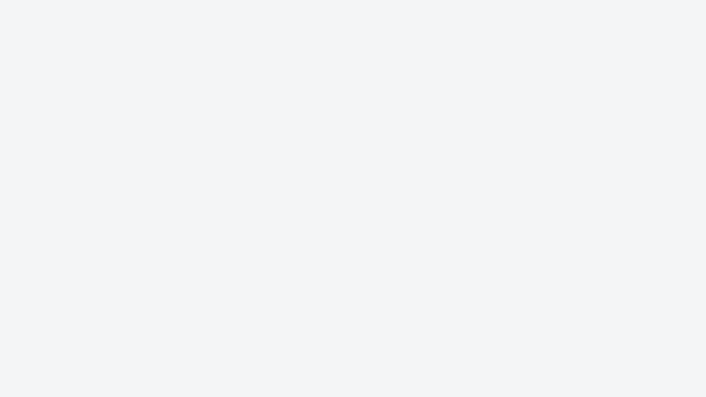

<p align="center">
	
	<br><br>
    Made with ❤️ (and a lot of

&nbsp;
<picture>
	<source media="(prefers-color-scheme: dark)" srcset="assets/ai-llm/chatgpt-dark.svg">
	
</picture>
)
<br>
</p>

# Table of Contents

- [Introduction](#introduction)
- [Demo (macOS)](#demo-macos)
- [Installation](#installation)
	- [macOS](#-macos)
	- [Windows](#-windows)
	- [Linux](#-linux)

# Introduction

This tool helps you keep track of your usage and stay within your limits. It currently supports:

- ChatGPT
- Claude

# Demo (macOS)

<p align="center">
	
</p>

# Installation

##  macOS

> [!IMPORTANT]
> Requires macOS 15 or later and Xcode.

1. Open `src/mac/FORL.xcodeproj` in Xcode.
2. For both the `FORL` and `FORLWidgets` targets, open **Signing & Capabilities**, select your team, and set **Signing Certificate** to **Development**. If Xcode reports that no certificate is available, create one in **Xcode > Settings > Accounts > Manage Certificates** with **+ > Apple Development**.
3. Build and install the app:

	```bash
	bash src/mac/build.command
	```

The app is installed to `/Applications/FORL.app`.

##  Windows

> [!IMPORTANT]
> Requires Python 3.10 or later.

```bash
pip install -r src/windows/requirements.txt
python src/windows/build.py
```

The executable is written to `src/windows/dist/FORL.exe`.

##  Linux

> [!IMPORTANT]
> Requires Python 3.10 or later with Tk to build. The executable it makes needs neither.

1. Install Tk and venv support for Python:

   | Distribution | Command |
   |---|---|
   | Ubuntu, Debian, Linux Mint, Pop!_OS | `sudo apt install python3-tk python3-venv` |
   | Fedora | `sudo dnf install python3-tkinter` |
   | Arch Linux, Manjaro | `sudo pacman -S tk` |
   | openSUSE | `sudo zypper install python3-tk` |

2. Build FORL in a virtual environment, since most distributions do not let `pip` install into the system Python:

   ```bash
   python3 -m venv .venv
   .venv/bin/pip install -r src/linux/requirements.txt
   .venv/bin/python src/linux/build.py
   ```

   The executable is written to `src/linux/dist/FORL`.

3. Put the executable where you want to keep it, for example `~/.local/bin`, and start it:

   ```bash
   install -D src/linux/dist/FORL ~/.local/bin/FORL
   ~/.local/bin/FORL &
   ```

   Turn on **Start at login** in FORL's settings to start it at every sign-in. Each launch also installs the KDE Plasma widget or the GNOME extension, on those desktops, and lets the widget and the extension start FORL when it is closed, so start the new executable once after you move or update it.

| Distribution (default desktop) | Tray icons | Panel and settings | Start at login | Status bar | Desktop widget |
|---|:-:|:-:|:-:|:-:|:-:|
| Ubuntu (GNOME) | ✅ | ✅ | ✅ | ✅\*\*\* | ✅\*\*\*\* |
| Fedora Workstation (GNOME) | ✅\* | ✅ | ✅ | ✅\*\*\* | ✅\*\*\*\* |
| Debian (GNOME) | ✅\* | ✅ | ✅ | ✅\*\*\* | ✅\*\*\*\* |
| Linux Mint (Cinnamon) | ✅ | ✅ | ✅ | ✅\*\*\* | ❌ |
| Arch Linux (none) | ✅\*\* | ✅ | ✅ | ✅\*\*\* | ✅\*\* |
| Manjaro (KDE Plasma) | ✅ | ✅ | ✅ | ✅\*\*\* | ✅ |
| openSUSE Tumbleweed (KDE Plasma) | ✅ | ✅ | ✅ | ✅\*\*\* | ✅ |
| Pop!_OS (COSMIC) | ✅ | ✅ | ✅ | ✅\*\*\* | ❌ |

\* Needs the [AppIndicator and KStatusNotifierItem Support](https://extensions.gnome.org/extension/615/appindicator-support/) GNOME extension, which Ubuntu ships turned on. Without a tray, FORL opens its panel as an ordinary window, and closing it quits.<br><br>
\*\* Depends on the desktop you install: the tray works on KDE Plasma, Cinnamon, XFCE, MATE, Budgie, COSMIC and in Waybar, and on GNOME with the extension above; the desktop widget needs KDE Plasma 6, or GNOME 45 or later.<br><br>
\*\*\* Needs a bar that shows a command's output, such as Waybar, Polybar or i3blocks, or on GNOME FORL's own extension (see below) or one such as [Executor](https://extensions.gnome.org/extension/2932/executor/).<br><br>
\*\*\*\* On GNOME the widget is an extension that shows the readings in the top bar and in a menu styled like the rest of GNOME, and needs GNOME 45 or later. Where FORL already has tray icons, as on Ubuntu, it stays hidden so the readings are not shown twice.

### Status bar

FORL writes each service's reading to `~/.cache/forl/claude.json` and `~/.cache/forl/chatgpt.json` in Waybar's format, and as plain text in `claude.txt` and `chatgpt.txt`: point a custom module of your bar at them.

### Desktop widget

On KDE Plasma 6, FORL installs its widget when it starts: add it from **Add Widgets**, to a panel or to the desktop. It is drawn with Plasma's own components, so it follows Breeze, light or dark, and any other Plasma theme. In a panel it shows each service's mark and the readings chosen for the tray, and opens the full view when clicked; on the desktop it shows the full view, with a progress bar for each usage chosen for the panel. Its buttons open FORL's panel to sign in or change the settings, and start FORL when it is not running.

Plasma keeps a widget's code in memory, so after FORL updates it, restart Plasma to see the new version:

```bash
systemctl --user restart plasma-plasmashell
```

### GNOME extension

On GNOME 45 or later, FORL installs its extension when it starts but does not turn it on:

1. Start FORL once, so it installs the extension.
2. Log out and back in. On Wayland, GNOME Shell only sees a newly installed extension, or a new version of it, after a new sign-in.
3. Turn it on in the **Extensions** app, or with

   ```bash
   gnome-extensions enable usage@forl.io
   ```

On Ubuntu, where the AppIndicator extension gives FORL tray icons, the extension stays hidden; turn AppIndicator off to use it instead.

The extension and FORL talk over the session bus: the readings reach the top bar as soon as FORL takes them, the extension tells you when FORL is not running, and signing in or the settings open FORL's own panel, starting FORL first when it is closed. While the extension is on, FORL opens its panel from the top bar as it would from a tray.
